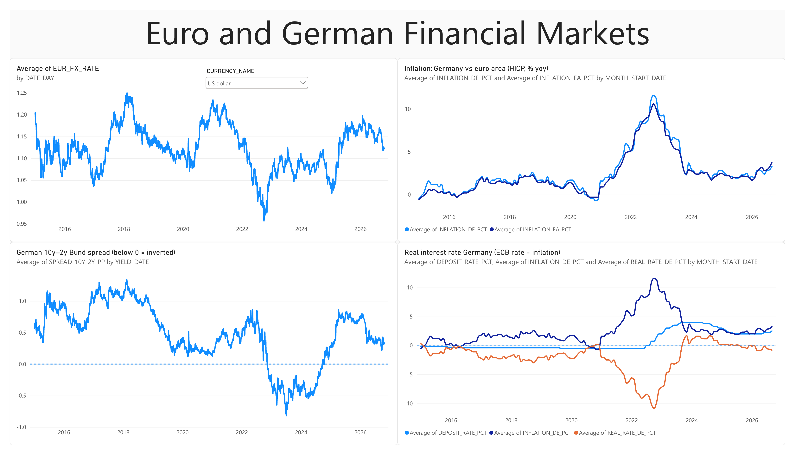
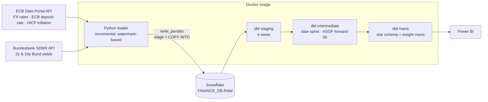
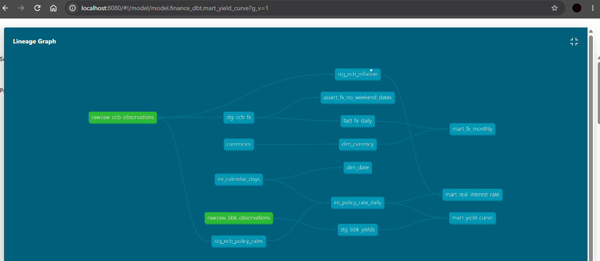
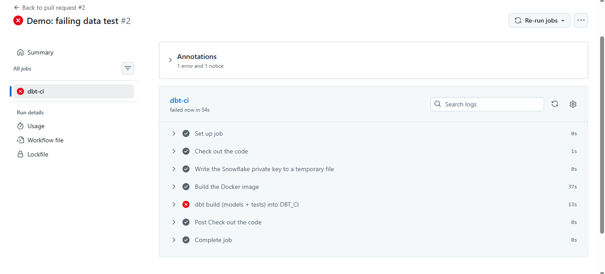

# Euro & German Financial Markets Pipeline

An automated ELT pipeline that ingests official **ECB** and **Deutsche Bundesbank** market data every weekday, models it with **dbt** on **Snowflake**, runs fully **containerized with Docker**, and is tested and deployed with **GitHub Actions** (CI on every pull request + daily scheduled production run). A **Power BI** dashboard sits on top of the production marts.



## Architecture



| Layer | What happens |
|---|---|
| **Extract + Load** (`ingest/`) | `requests` with retries/timeouts calls 5 SDMX endpoints. Per series it reads a **watermark** (latest loaded period) and fetches only newer data, then appends it to `RAW` via `write_pandas`. Re-runs are idempotent (0 new rows). RAW keeps the API values unchanged as text, plus `LOADED_AT`. |
| **Staging** | One view per topic: filter the series, cast text → `DATE`/`NUMBER` with `TRY_` functions, parse codes from the series key, deduplicate (latest load wins). |
| **Intermediate** | `int_calendar_days` (date spine since 2015) and `int_policy_rate_daily`: the ECB rate only exists on change dates, so it is **forward-filled with a Snowflake `ASOF JOIN`**. |
| **Marts** | `dim_date`, `dim_currency` (dbt **seed**), `fact_fx_daily` (**incremental, MERGE** with lookback window), plus insight marts `mart_yield_curve`, `mart_real_interest_rate`, `mart_fx_monthly`. |



## Key insights from the data

- **The German yield curve was inverted on all 255 trading days of 2023** (10y–2y Bund spread < 0), from late 2022 (36 days) to 2024 (187 days), the classic recession signal during the ECB's hiking cycle. Normal again since 2025.
- **Savers lost ~11% of purchasing power at the peak:** in October 2022 the ECB deposit rate was 0.75% while German HICP inflation was 11.6%, a **real interest rate of −10.85%**. In May 2022 the ECB rate was still negative (−0.50%) with inflation already at 8.6%.
- Germany and the euro area followed almost the same inflation path; German inflation peaked slightly higher in late 2022.

## Data quality

**45 dbt tests** run on every build:
- `unique` / `dbt_utils.unique_combination_of_columns` on every grain (e.g. currency + date)
- `not_null` on keys and values (catches anything `TRY_` casts could not parse)
- `accepted_values` (currencies, countries, maturities)
- `dbt_utils.accepted_range` on plausible ranges (FX > 0, inflation −5…15%, yields −2…10%)
- `relationships` from the fact table to its dimensions (star schema integrity)
- custom SQL test: **no FX rates on weekends**
- **source freshness** on RAW (`warn` after 2 days, `error` after 4)

## CI/CD

| Workflow | Trigger | Does |
|---|---|---|
| `ci.yml` | every pull request to `main` | builds the Docker image, runs `dbt build --target ci` into an isolated `DBT_CI` schema |
| `daily.yml` | Mon–Fri 16:30 UTC (after the ECB's ~16:00 CET publication) + manual | loader → `dbt source freshness` → `dbt build --target prod` into `DBT_PROD`; GitHub emails on failure |

`main` is protected by a ruleset: changes only via pull request, and the `dbt-ci` check must pass. A deliberately too-strict test (1 EUR ≤ 100 JPY) was used to prove that a failing data test **blocks the merge**:



## Security

- Snowflake **service user** (`TYPE = SERVICE`) with **key-pair (JWT) authentication**, no passwords
- Least-privilege role `DBT_ROLE` that owns only its own schemas; Power BI reads `DBT_PROD` through a separate read-only role
- Secrets via `.env` locally (git-ignored) and **GitHub Secrets** in CI; the private key is mounted into the container read-only at run time and is never baked into the image

## Tech stack

Python 3.11 (requests, pandas, snowflake-connector-python) · Snowflake · dbt Core 1.12 + dbt_utils · Docker / docker compose · GitHub Actions · Power BI

## Run it locally

```bash
# 1. .env in the repo root (see variable names below) + private key in ~/.snowflake_keys/rsa_key.p8
# 2. build the image and run the whole pipeline (loader + dbt build into DBT_DEV)
docker compose build
docker compose run --rm pipeline

# one-off commands, e.g. only the freshness check
docker compose run --rm pipeline sh -c "cd finance_dbt && dbt source freshness"
```

`.env` variables: `SNOWFLAKE_ACCOUNT`, `SNOWFLAKE_USER`, `SNOWFLAKE_ROLE`, `SNOWFLAKE_WAREHOUSE`, `SNOWFLAKE_DATABASE`, `SNOWFLAKE_PRIVATE_KEY_PATH`.

## Lessons learned (real issues hit while building)

- **API change:** the ECB discontinued its `ICP` inflation dataset in February 2026; the pipeline uses the new `HICP` dataset.
- **Content negotiation:** without an `Accept-Language` header the Bundesbank API answered in German with `;` as delimiter. The loader requests English and detects the delimiter defensively.
- **Dependency pinning:** an unpinned install made pip backtrack to a 2019 dbt release (incompatible with Python 3.11). All versions are now pinned exactly.
- **Optimizer order:** an incremental run failed because Snowflake pushed a filter into a view and cast dates of another series first. Staging now uses `TRY_` casts, and `not_null` tests catch real parse failures.
- **Leftover packages:** a beta install left behind a plugin that tried to log into a paid cloud service. A clean Docker image built from the pinned requirements avoids this class of problem.

## Repository structure

```
ingest/                 Python loader + Snowflake connection (key-pair auth)
finance_dbt/            dbt project (staging / intermediate / marts, tests, seed, profiles for dev/ci/prod)
.github/workflows/      ci.yml (pull requests) and daily.yml (schedule)
Dockerfile              image with Python, pinned libraries, loader, dbt + packages
docker-compose.yml      local run configuration
docs/                   screenshots (dashboard, lineage, CI)
euro_financial_markets.pbix   Power BI report (Import mode on DBT_PROD)
```

## Data sources

- Source: ECB, [ECB Data Portal](https://data.ecb.europa.eu/) (EXR, FM, HICP)
- © Deutsche Bundesbank, [Bundesbank statistics / SDMX web service](https://www.bundesbank.de/en/statistics/time-series-databases/help-for-sdmx-web-service) (BBSSY)

Costs: €0. Free public APIs, dbt Core, Docker Desktop, GitHub Actions on a public repo, and the Snowflake trial (≈0.03 credits per daily run).
